# Build log: Cologne Cathedral Explorer (Claude Opus 5.5, Track A)

Claude Opus 5.5, running in autopilot mode in the GitHub Copilot app, built *Cologne Cathedral Explorer*: a Copilot managed application showing an interactive three.js model of Cologne Cathedral whose geometry is generated entirely in code (Track A). It researched and measured the reference material first, then wrote a procedural geometry library, the nave, towers, chevet and a shader pipeline before rendering its first frame at 21:37, 6 h 50 min after the first prompt. From then on it worked in loops: take Playwright screenshots, review them critically, trace each fault to a specific line or parameter, fix, rebuild and re-shoot. In the next three and a quarter hours it went from a recognisable but washed-out shell with no city, furnishings or interface to a furnished interior, an excavation level, a city setting with the Rhine and the Hohenzollern Bridge, and a full interface with levels, sections, 33 places, a 13-stop tour and a 533-step tower climb. That stretch ended at 00:51 with a GPU-level performance diagnosis that roughly halved interior frame times. The model then deployed the app to the managed-app player and verified it there. The player screenshots showed place labels bleeding through the side panels, so it rewrote the label layout, redeployed and verified again. The whole run, including this log, took 11 h 55 min from the first prompt (see [Total time](#total-time)).

## Brief, model and runtime

The user submitted the fixed Track A kickoff prompt from the pack's `RUBRIC.md`, word for word:

> Build the managed application described in BRIEF.md. RESEARCH-LINKS.md and the images in references/ are research material: study them to learn what Cologne Cathedral looks like, then build your own interpretation. Track A: generate all geometry procedurally in the app. First-person walking is not required. When finished, give me the self-check table described in BRIEF.md section 6.

| Item | Detail |
|---|---|
| Model and harness | Claude Opus 5.5 in the GitHub Copilot app, autopilot mode |
| App stack | Copilot managed application (`ms app create`), Vite, three.js 0.187 (the React template was removed) |
| Test GPU | Qualcomm Adreno X1-85 via ANGLE/Direct3D 11, headless Edge driven by Playwright |
| Period covered | First prompt 14:47:06 on 18 Nov 2026 to completion at 02:42 on 19 Nov (UK time, the same as UTC in November); 86 checkpoints |
| User messages | Three: the kickoff prompt (14:47:06), the request for this log (00:52:45) and the request to record the total time (01:01:30). No repair, guidance or "continue" prompts |
| Deployments | Two, to the Copilot managed-app player: commit `5c5ab91` at 01:16 and commit `9f47391` (final) at 02:00 |
| Total time | 11 h 55 min from the first prompt to completion. The final app was deployed 11 h 13 min after the first prompt and fully re-verified in the player after 11 h 20 min (see [Total time](#total-time)) |

## Timeline

Up to 00:51, times are the timestamps of the checkpoints that close each phase; later times come from the session's event log. Research continued alongside coding, so some phases overlap.

| Phase | Time span | Checkpoints | Outcome |
|---|---|---|---|
| Research and measuring the references | Up to 15:28, plus 16:24–16:34 and 19:22–19:32 | 1–4, 8–9, 27–28 | Brief, rubric and links read; official cathedral pages fetched; a background agent verified 26 points of interest; plan P02 and façade photo X01 measured by pixel |
| Architecture and data | 15:17–16:44 | 3–10 | Module design, app shell, and `data.ts` (~496 lines: sources, levels, views, hotspots, tour, climb, key figures, estimates) |
| Geometry library and body | 16:44–19:13 | 11–24 | Plan constants, mesh builder, a ~700-line library of parametric Gothic parts (arches, foils, tracery, crockets, pinnacles, gables, vaults, piers, bells, finial), then nave, aisles, transept, crossing, flyers and roofs |
| Towers and spires | 19:13–20:33 | 25–33 | West towers and openwork spires, written in four chunks |
| Chevet | 20:33–21:12 | 34–37 | Choir, apse, ambulatory, seven radiating chapels, buttresses, flyers and roofs |
| Render pipeline | 21:12–21:36 | 38–40 | Patched three.js materials (~420 lines), lighting and sky, camera rig, engine |
| First build and visual-fix loops | 21:36–22:29 | 41–47 | Five screenshot iterations: glass, interior light, city, furnishings, below ground |
| Full UI | 22:29–00:14 | 48–69 | Views, levels, sections, places, search, tour, climb, minimap, 2D plan, About, accessibility |
| Automated testing and visual polish | 00:14–00:36 | 69–71 | `ui.mjs` suite: 32/37, then 51/52, then 36/37 (desktop); camera and sun fixes made in source |
| Performance investigation and fix | 00:36–about 00:51 | 71–73 | Discard-free shaders and interior culling; interior GPU time roughly halved |
| Label occlusion and full-suite runs | 00:51–01:13 | 74–75 | World labels hidden behind 13 coarse mass boxes (R13); ui4 37/37 on desktop, then ui5 52/52 across all five suites |
| Build-log draft, in parallel | 00:57–01:32 | – | After the user's request, a `buildlog-writer` subagent drafted this log from the checkpoints and screenshots while the main agent carried on |
| Commit, push and first deployment | 01:14–01:16 | 75–76 | Commit `5c5ab91`; the push needed a credential-manager retry; `ms app deploy` took 52 s |
| Verification in the player | 01:19–01:31 | 76–77 | Signed-in Edge driven over CDP: `player.mjs` 16/16, `player2.mjs` 7/7, rubric-style 10 s fps counter passed |
| Label-layout polish | 01:33–01:59 | 78–81 | Labels and markers kept clear of panels, key figures and each other (R14, R15); ui6 52/52, `labelcheck.mjs` zero overlaps in 12 states, ui7 52/52; commit `9f47391` |
| Redeployment and re-verification | 01:59–02:07 | 81 | Deployed in 61 s; player 16/16, player2 7/7, fps counter passed; the served files were later confirmed byte-identical to the local build |
| Evidence, this log and wrap-up | 02:07–02:42 | 81–86 | Before-and-after sheets, header crops, redacted results; the untested fallback paths found and tested (4/4); the final sections of this log, clean-up |

**Growth in numbers**

| Stage | Triangles | Draw calls | Meshes | Load |
|---|---|---|---|---|
| Iteration 1 (21:37) | 589k | 26 | 25 | 2.1 s |
| Iterations 2–3, city added (21:47–21:51) | 649k | 36 | 35 | 2.4 s |
| Iteration 4, furnishings and below ground (22:19) | ~687k | – | 55 | – |
| Performance build (about 00:51); geometry unchanged in the final build `9f47391` | 686,847 generated, 668,251 drawn at the home view | 50 | 55 merged + 36 instanced (3,444 instances) | 2.4–2.7 s locally; 6.0–7.3 s in the player, including the player's own start-up |

Every screenshot iteration reported 60 fps, apart from one 29 fps first shot while shaders warmed up. The interior frame-rate problem only surfaced under the automated suite (R10–R12 below).

## How the model got more detailed

### Research: studying and measuring the references

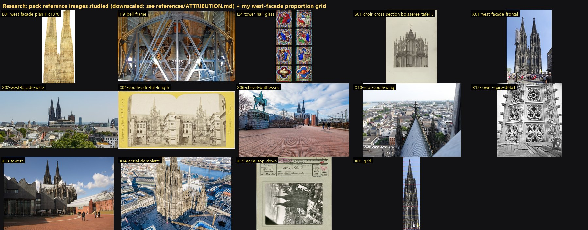

The pack holds 97 Wikimedia Commons images. The model studied about 18 in a first pass (plans, sections, exterior and interior), fetched the official cathedral site ("Der Dom in Zahlen" and the tower-climb page) and English Wikipedia, and later made downscaled copies of the tower references to design the spires. Typical notes it took:

| Reference | What it noted |
|---|---|
| S01 choir cross-section | Two tiers of double flying buttresses; hipped, flat-topped lead aisle roofs; gables over the clerestory |
| X12 spire | Openwork of square frames with foiled rosettes and crockets |
| X06 chevet | Seen from the bridge promenade; the bridge axis runs just north of the cathedral axis; light grey-blue lead roof |
| X18 night | Floodlit stone; crossing lantern with a star |
| I04 and I18 interior | Swallow's-nest organ on the north wall; blue grisaille clerestory; red-orange iron roof trusses |
| P03 tower plan | Paired buttresses at each tower corner; a narrow centre between the towers |

**What to notice:** the last panel, `X01_grid`, is the model's own measuring aid: a red 0–160 m height scale drawn over the frontal façade photo (see R2).

### Iteration 1: first build (21:37)

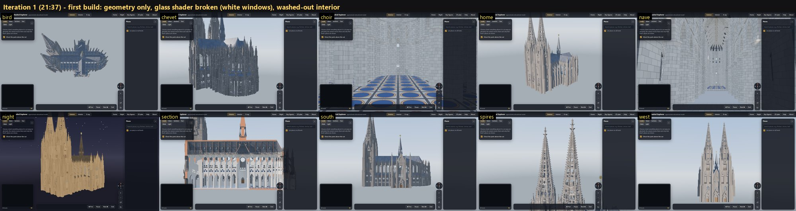

- **Added:** body, towers, chevet, materials, lighting and camera, all rendered for the first time. The interface was stubs only.
- **Already right:** twin openwork spires with crockets, the crossing flèche with a gold star, flying buttresses, the cruciform lead roof, hatched cut faces in the section view and golden night floodlighting.
- **Wrong:** windows showed white sky (R3); the nave was washed out (R4); the choir mosaic floor was garish; there was a white patch on the roof, a shadow-type console warning, a playbar showing despite `hidden`, and the framing of the home and chevet views.
- **Reasoning:** the roof patch was "probably lead mirroring the sky", so lead got roughness 0.62 and metalness 0.25; three r187 had removed soft PCF shadows, so plain PCF was used.
- **What to notice:** a grey void with no city, the washed-out nave, the bright blue mosaic floor and a black minimap.

### Iteration 2: glass renders, city added (21:47)

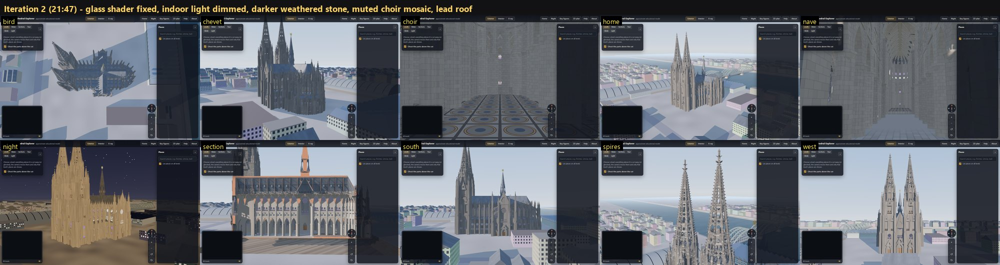

- **Added:** the iteration-1 fixes and `context.ts` (~230 lines): the Domplatte, the station's barrel-vaulted hall, museums, the Rhine and a three-span Hohenzollern Bridge.
- **Wrong:** at night the windows were white or lavender blobs because the glass's far-distance mean colours were too bright and pale. Inside, the nave was flat, cool grey and low in contrast, the choir was empty and the floor looked bluish.
- **What to notice:** the city appears here, not in sheet 03 as that file name suggests. The section view already shows arcade, triforium, clerestory and the iron roof trusses.

### Iteration 3: glass tuning (21:51)

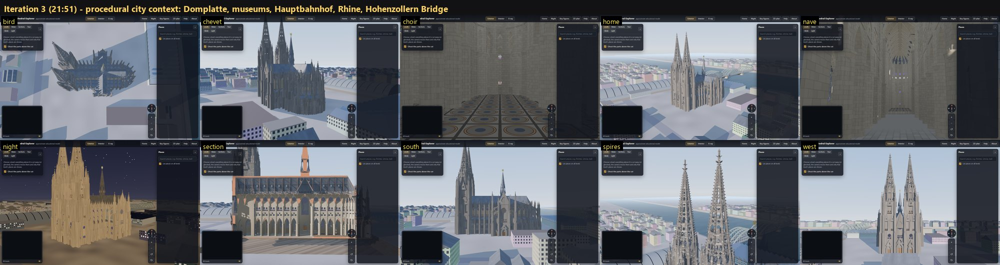

- **Changed:** new far-distance mean colours for the glass, replacing the pale ones, and `toneMapped: false` on the glass.
- **Result:** night windows turned deep blue and purple; the model judged the uniformly tan floodlit façade acceptable. A pixel comparison made for this log shows that only the night, nave and choir panels differ from sheet 02.
- **Still wrong:** the nave was still flat grey with a dark navy clerestory. Its next step was a warm emissive glow that rises with height, brighter daylight glass seen from inside, and a deep blue far colour for the medieval glass.

### Iteration 4: furnishings and below ground (22:19)

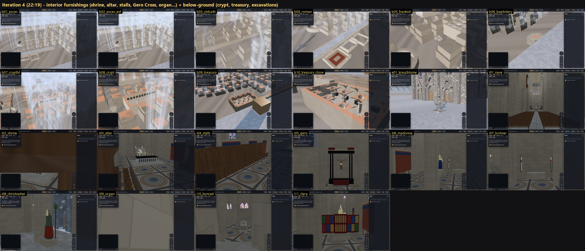

- **Added:** `interior.ts` with 13 builders (Shrine of the Three Kings, high and crossing altars, choir stalls and screens, pews, Gero cross, Madonna, Lochner triptych, Clara altar, Christopher, Konrad tomb, organ, Kreuzblume replica) and `below.ts` (dig floor, foundations, crypt, treasury, ruins, the old cathedral, Roman and Frankish remains, baptistery). Shots b01–b10 are below ground, e01 is the Kreuzblume and i01–i11 are the interior.
- **Fixed while writing:** slab normals, ~6 mm anti-z-fighting offsets, a negative niche width that broke arches, and the crypt level cut (lowered from −0.6 to −2.2 m).
- **Wrong:** orange hatch on the baptistery font ring (b06, R6); a pale dig floor; the shrine camera sat inside the choir stalls (the brown wall in i02); the organ camera sat inside a pier (the blank beige in i09); the Konrad view was too far away (i10); the Lochner centre panel was invisible (i07, R5); the interior still read grey.

### Iteration 5: interior fixes (22:25)

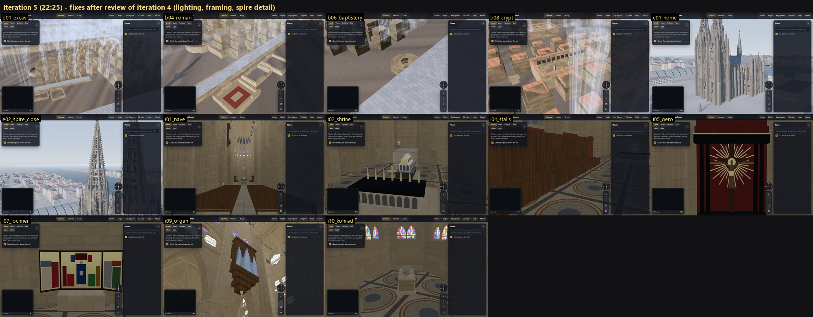

- **Changed:** altarpiece and cross moved out of the wall (R5); warm interior lighting (R4); darker earth and an aged tone for stone below −0.8 m; hole winding fixed (R6); new cameras, for example the organ seen from [−21, 7, 4] looking up to [−11.6, 20, −6.6].
- **Result:** every fix was confirmed in the screenshots.
- **What to notice:** the warm golden nave, the shrine behind a candle-lined altar, the Gero cross with its gold sunburst, the coloured Lochner triptych, the hanging organ, a close view of the Konrad tomb and the font without hatch.

### Full UI, first automated run (ui1, about 00:14)

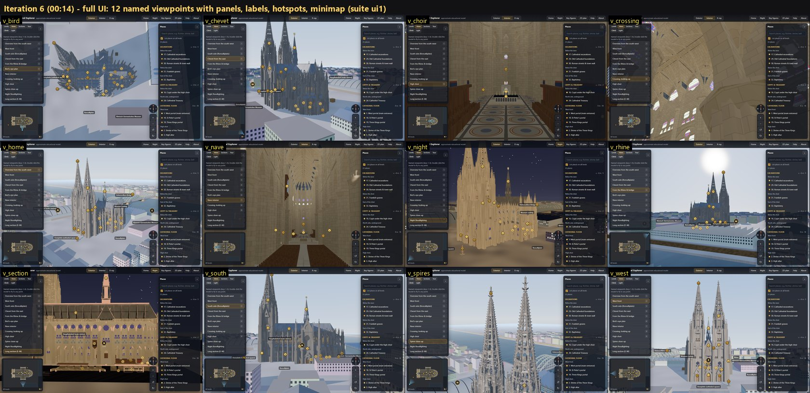

- **Added (about 1 h 45 min of work):** the interface: plan drawing, minimap, places, figures, tour, climb, About, 2D plan, controls and a ~480-line orchestrator. Before coding, the model checked the rubric's wording against what existed and closed the gaps (R7).
- **Shows:** 12 named views; the Places list grouped by level ("33 places"); gold hotspot markers; world labels; the minimap.
- **Wrong:** a huge sun in the Rhine view and spires cropped in the section view (see the next sheet).

### The sheet the user pasted back

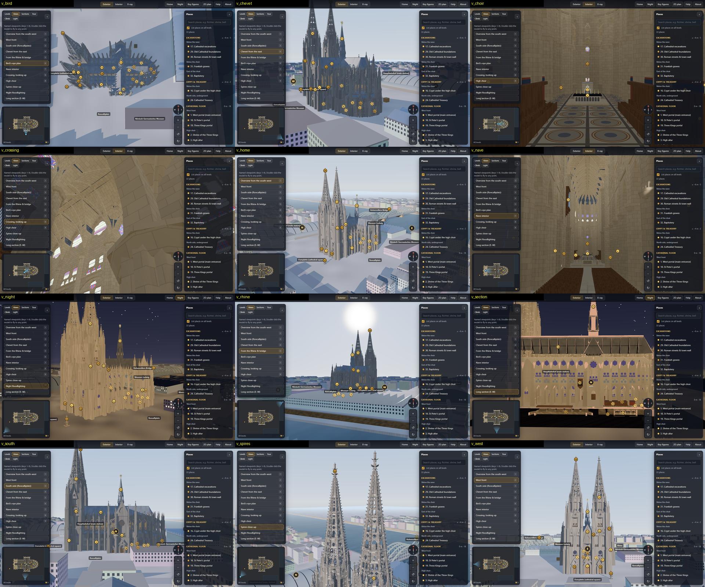

The user pasted this pre-polish sheet back into the chat when asking for this log. The model's review of the ui2 run had already found the faults. The Rhine camera at [340, 42, −170] sat on the bridge deck, so the bridge was behind it. The sky shader's sun disc was about 8° wide. The section camera, 150 m away, cropped the spires; the section is at night because night mode carries over between views by design. Fixes, made in source: the Rhine camera moved to [430, 32, −300] ("Classic view from the river, past the arches of the Hohenzollern Bridge."), the sun shrank to about 0.6° radius with a halo, and the section camera moved to [−5, 76, 249].

### "After polish" views (ui3, 00:33)

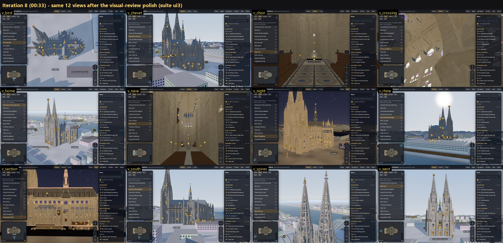

**Caution:** despite the file name, this sheet does not show the polish. The ui3 run started before those edits, which stayed in source until the performance build. A pixel comparison made for this log finds only JPEG noise against sheet 06 (mean difference 0.04–0.33 out of 255 per panel), so the big sun and the cropped section remain; the corrected views first appear in sheet 10. ui3 passed 36 of 37 desktop checks. The one failure, a nave median of 23 fps, started the performance work (R10).

### Performance-fix verification (v1, 00:51)

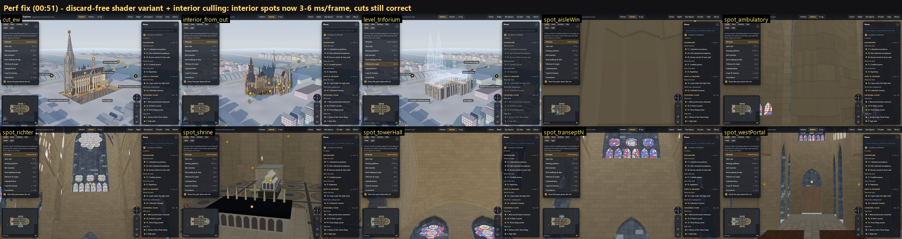

These shots check that the faster rendering path broke nothing (R11–R12): seven interior spots (the west portal with its door solid, an aisle window, the tower hall, the ambulatory, the north transept, the Richter window and the shrine), the daytime east–west section with hatched cut faces, the triforium level cut with the ghost above, and the interior seen from outside through the camera cut-away.

### Final views (ui5, 01:13)

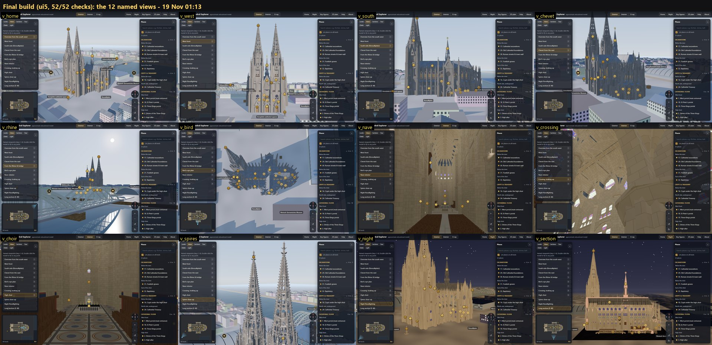

This sheet is from a later run, after the performance fix, and is titled "Final build (ui5, 52/52 checks)". Compared with sheets 07 and 08, both faulty views are fixed: the Rhine view looks across the river past the arches of the Hohenzollern Bridge, under a small sun with a halo, and the long section now frames the whole length of the building, spire included.

### Feature sheets

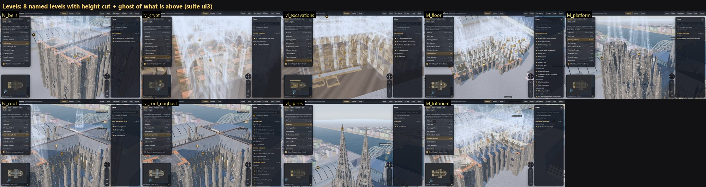

**Levels:** eight named levels, from the spire tips (157 m) and the viewing platform (97.25 m) down to the crypt and the excavations. Each one cuts the model at a height, with optional ghosting of what is above.

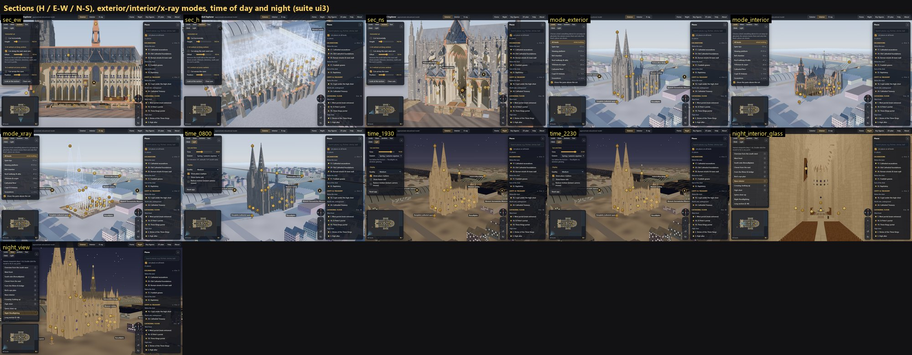

**Sections, modes and light:** east–west, north–south and horizontal sections; exterior, interior and x-ray modes; light at 08:00, 19:30 and 22:30; night glass; the night view.

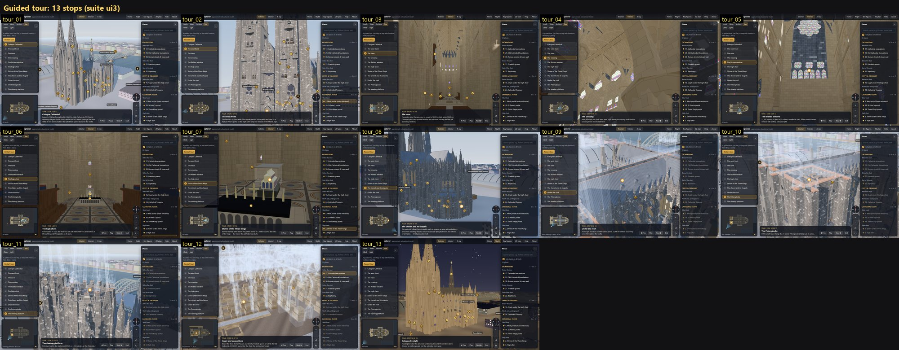

**Tour:** 13 stops, from the west front to the excavations and a floodlit night view, with Prev/Pause/Next/End controls.

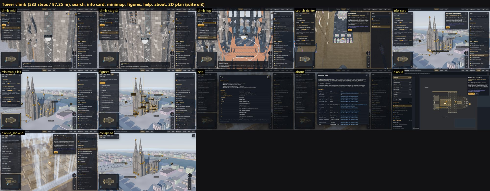

**Climb, search and panels:** the 533-step, 97.25 m climb in five stages with a glowing spiral route; search; the info card; the minimap; key-figure dimension labels; help; About; and the 2D plan with "show in 3D".

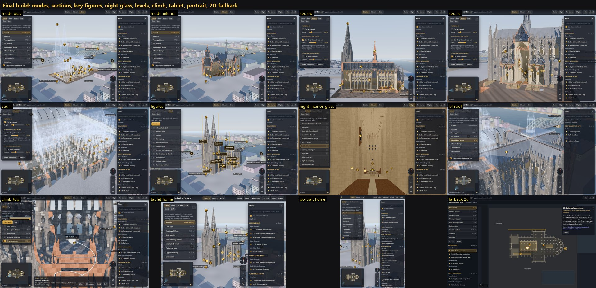

**Final build (ui5, 01:13):** x-ray and interior modes; east–west, north–south and horizontal sections; key figures; night glass seen from inside; the roof-walkway level; the top of the climb (step 533 of 533); tablet and portrait layouts; and the 2D fallback.

### In the managed-app player (first deployment, 01:27)

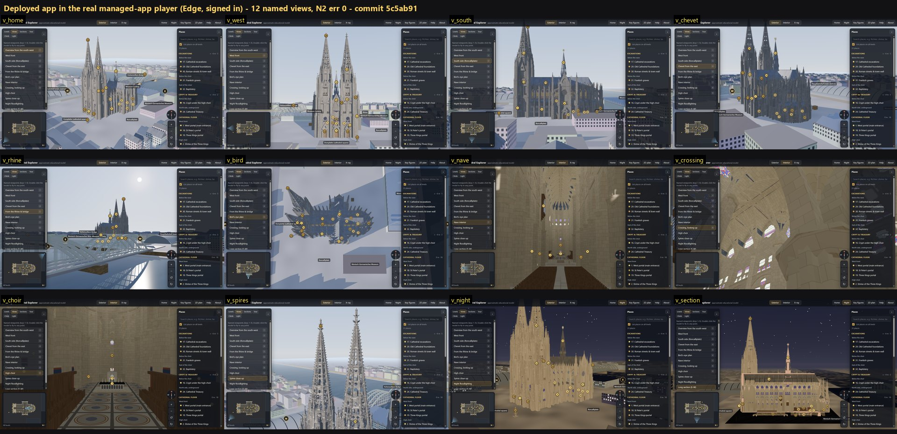

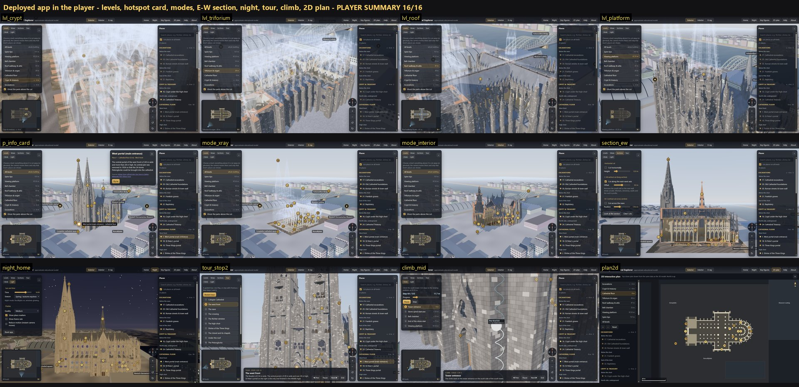

The first deployment (commit `5c5ab91`) was checked in the real managed-app player, not only in the local preview. A separate, signed-in Edge profile was driven over the Chrome DevTools Protocol, and the test scripts worked inside the player's app frame. Sheet 11 shows the 12 named views; "N2 err 0" in its title means every view's camera arrived exactly where it was defined. Sheet 12 shows four levels (crypt, triforium, roof and platform), a place card, x-ray and interior modes, the east–west section, night, a tour stop, the middle of the climb and the 2D plan. `player.mjs` passed 16 of 16 checks and `player2.mjs` 7 of 7 (see [Deployment and final verification](#deployment-and-final-verification)).

**What to notice:** the views match the local sheet 10, so the deployed build draws the same scene. The player's own header, which shows the signed-in account, has been cropped from every player image (see [Privacy and redaction](#privacy-and-redaction)).

### What the player screenshots showed: labels through the panels (01:27–02:05)

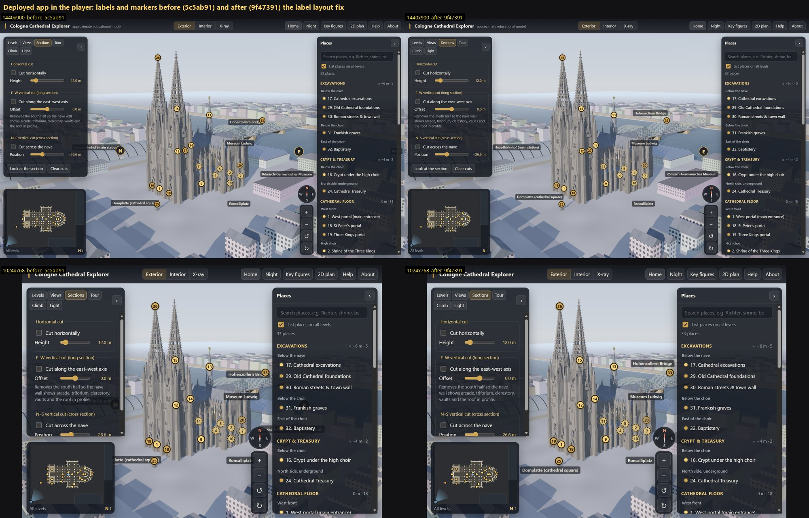

The functional suites had passed 52 of 52, but the player screenshots showed something no check measured: place names and markers drawn *through* the side panels and cutting into each other (R14). The left column is the first deployment (`5c5ab91`) and the right column the final one (`9f47391`), at 1440 × 900 (top) and 1024 × 768 (bottom).

- **Before:** "Hauptbahnhof (main station)" and the N compass label show faintly through the Sections panel. "Römisch-Germanisches Museum" runs under the Places panel at 1024. Marker 33 cuts into "Hohenzollern Bridge" and marker 25 into "Domplatte (cathedral square)"; at 1024 the minimap also covers Domplatte, and "Roncalliplatz" runs under the zoom buttons.
- **After:** every label still shown is whole and clear of panels and markers. At 1440 × 900, seven remain (Hohenzollern Bridge, Hauptbahnhof (main station), Römisch-Germanisches Museum, Museum Ludwig, Roncalliplatz, Domplatte and E); only N is hidden. At 1024 × 768 there is less free space, so four place names remain (Hohenzollern Bridge, Museum Ludwig, Roncalliplatz and Domplatte). The station, the Roman museum and the compass letters are hidden there rather than drawn under a panel.

### Key figures: three layers competing for the same pixels (01:48–01:58)

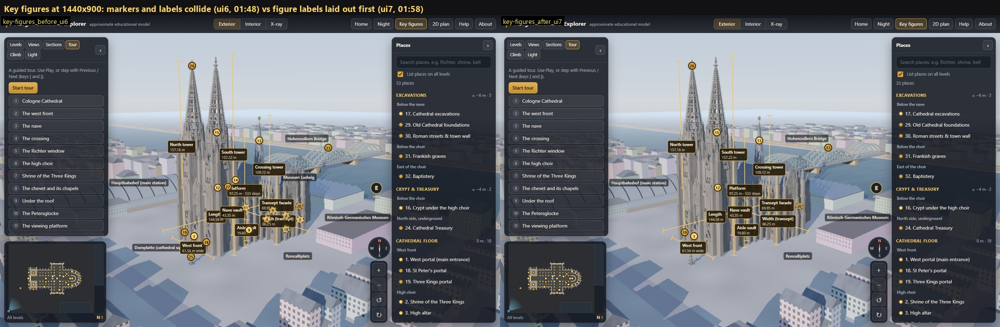

The first fix (R14) cleared the panels but exposed a second collision in Key figures mode, where ten dimension labels share the screen with numbered markers and place names (R15). In the ui6 run (left, 01:48), markers sit on the figure labels' text: "[27]latform", "Aisle [9]lt" and "W[4]dth (tran[2]ept)". "Length" runs into "Nave vault", and "West front" sits on "Domplatte (cathedral square)". In ui7 (right, 01:58) the figure labels are laid out first, markers that would touch them are hidden, and place names use the space that is left (Domplatte and Museum Ludwig give way). All ten figures read cleanly: North tower 157.18 m, South tower 157.22 m, Crossing tower 109.12 m, Platform 97.25 m · 533 steps, Transept facade 69.95 m, Nave vault 43.35 m, Length 144.58 m, Width (transept) 86.25 m, Aisle vault 19.80 m and West front 61.54 m wide.

### The overlap audit (labelcheck, 01:52)

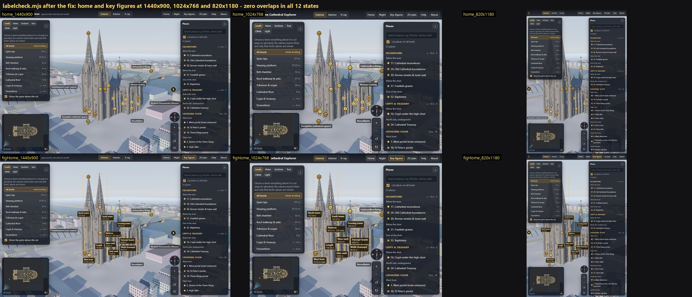

To stop relying on eyesight, the model wrote `labelcheck.mjs`. It reads the on-screen rectangle of every visible label, marker, figure label and panel, and lists five kinds of fault: a label under a panel, a label off screen, a marker under a panel, a label on a marker, and a label on another label. It audits four states (home; after an orbit; Key figures at that orbited camera; and Key figures from home, the I4 framing) at three sizes (1440 × 900, 1024 × 768 and 820 × 1180 portrait). After the fix, all five lists were empty in all 12 states. The sheet shows the home and Key-figures-from-home states at each size.

**What to notice:** what remains visible is a deliberate trade-off. The home view keeps six place names, E and 19 markers at 1440 × 900; four names and 18 markers at 1024 × 768; and Domplatte, N and 13 markers in portrait. With Key figures on, all ten figures show (nine in portrait) and markers drop to 8, 5 and 7. The raw numbers are in `polish/labelcheck.json`.

## Reasoning highlights

Each item follows the pattern Problem → Evidence → Reasoning → Fix → Result.

**R1. Scaling the plan from one number.** *Problem:* the plan, and especially the chevet, needed positions in metres. *Evidence:* plan P02 (1280 × 2115 px). *Reasoning:* take the transept's full extent on the plan, 1,272 px, as 86.25 m (about 14.6 px/m) and measure everything else in pixels. With scipy missing, it used PIL and numpy for colour classes, connected components and radial scans from two candidate apse centres. *Measured:* the east end sits ~67.3 m and the west end ~76.6 m from the crossing, with choir pier lines at x = 22.8, 30.4 and 38. *Decision:* the apse centre moved from x = 38 to 42, giving an inner apse with seven narrow sides at radius ~7.3–7.6 m, an ambulatory at ~15.2–16 m, chapel walls at ~21.8–23 m, buttresses to ~25.5 m and a narrow transitional bay between x = 38 and 42.

**R2. Heights from a foreshortened photo.** *Evidence:* a 0–160 m grid over façade photo X01 gave apparent storey heights of ≈30 m, ≈58 m and ≈85 m, an octagon at ≈85–110 m, the spire at ≈110–150 m and the finial at 157 m. *Reasoning:* the photo looks up at the towers, so upper parts read too high. Corrected for perspective, it supports a square tower to 76 m, an octagon to ≈97–100 m and the spire above. *Fix:* the towers were built to that profile, with P03's paired corner buttresses.

**R3. White windows: a shader that never compiled.** *Problem:* windows showed white sky. *Evidence:* a shader error on the glass. *Reasoning:* the `VERT_WORLD` vertex snippet used `objectNormal`, which MeshBasicMaterial's vertex shader does not have, so the glass never rendered and the openings showed the sky. *Fix:* `vec3 cn = normal;`. *Result:* glass rendered from iteration 2, and its colours were then tuned.

**R4. Washed out, then grey, then warm.** *Problem:* the interior was washed out, then flat grey for three iterations. *Approach:* reduce the indirect light only on surfaces inside the building, then add warmth step by step. *Fix,* in three passes:
1. An `INDOOR` shader snippet tests whether a point 0.3 m off each surface is inside the building and, if so, scales indirect diffuse light by 0.42 and specular by 0.3 (on stone, floor, wood and paint).
2. A warm emissive term rises with height.
3. A warm indirect tint (1.0, 0.83, 0.6) × 0.55, warmer stone, a warmer `LAMP` term and a warmer floor.

*Result:* the golden nave of iteration 5.

**R5. The altarpiece inside the wall.** *Problem:* the Lochner centre panel was invisible. *Evidence:* a comment in its own `chevet.ts` (line 168): the outer-aisle end wall spans x 40.8–42. *Reasoning:* the Lochner and Gero panels at x = 41.5 were buried in that wall, and only the angled wings stuck out. *Fix:* move both to x = 40.8. *Result:* both are visible in iteration 5.

**R6. Orange hatch from inside-out holes.** *Problem:* the font ring showed the orange hatch reserved for cut faces. *Reasoning:* this pointed to inside-out faces around the shape's holes. three's ExtrudeGeometry only fixes hole winding when it reverses the outer contour, so holes wound the same way as the outline produced inside-out walls. *Fix:* `shape()` now winds every hole opposite to the outline, using a signed-area helper. *Result:* the hatch disappeared. The same fix applies to the spire panels and all tracery.

**R7. Taking the rubric and the data literally.** Several decisions came from checking rubric wording and data against what actually existed:
- "Key figures" → 3D dimension lines, not human figures.
- M8 wants labelled compass directions in the 3D scene → projected world labels (N/E/S/W and place names).
- Help listed Q/E for down/up *and* E/I/X for modes → E/I/X kept; vertical moved to Q (down) and R (up).
- The canvas's accessible name said "W A S D pan" while help said "move" → reworded to list every key.
- I6 wants a *highlighted* climb route → a glowing route overlay.
- The bridge hotspot [420, 22, −52] missed the bridge (z −201 to −158) → moved to [367, 30, −180].
- Petersglocke → the bell-chamber level, whose 55.5 m cut keeps the bell (53 m) in view.

**R8. A camera cut-away that keeps the sunlight.** Seeing inside from outside means removing the near part of the building. As a clipping plane, that cut would also apply to shadows. The model used a uniform-driven discard (`uCamCut`) instead, so the shadow pass ignores it and sun shafts still come through the windows. The same discard later turned out to be half of the performance problem (R11).

**R9. Test failures that were state bugs.** The ui1 run passed 32 of 37 checks. The camera started at [0, 3, 0] because nothing applied the home view at start-up, which also caused the N1 pan, wheel and keyboard failures; the fix was to fly home at init. In the Q3 shortcuts test, a reopened 2D plan kept a stale selection, so the first Escape only deselected it and the still-open plan swallowed the `h` key; the fix was to deselect on open and let Escape close the plan first. The ui2 run then passed 51 of 52.

**R10. App defect or busy machine?** *Problem:* ui2's one failure was the "Q1 fps interior + night" check (interior 29 fps, night 48). *Evidence:* profiling showed random dips to 6–18 fps on whichever view was being measured, while other processes were using the GPU (msedgewebview2 at 21% and 14%, msedge at 12%). *Reasoning:* random dips point to contention, so the probe became the median of five 1 s samples. ui3 then showed a *steady* nave median of 23 fps (27, 26, 22, 23, 23): not noise. *Check:* re-reading the rubric, Q1 requires ≥30 fps in the default exterior view and in x-ray over a 10 s counter. A rubric-style counter gave home 60.1, x-ray 60.3, nave 45.3, nave x-ray 60 and night 60, so Q1 already passed. *Decision:* fix the interior anyway.

**R11. Discard defeats early-z.** *Evidence:* in the nave (40 fps base), hiding the city (47), exterior adornments (48), glass (46) or instanced meshes (49), or removing the environment map (51), helped only a little. Hiding the main structure, or dropping the pixel ratio to 0.6, gave 60. So the view was fill-rate bound. Removing every `discard` also gave a locked 60. *Reasoning:* every cathedral material could discard, because three.js section-clipping planes were always attached and the cut-away added another. On this tile-based mobile GPU, a shader that may discard disables early depth rejection. So in the heavily overdrawn interior, with pews, piers and vault ribs behind one another, every hidden fragment ran the heavy stone shader. A GPU timing script (12 back-to-back renders, then a readPixels sync) confirmed it:

| View | Before (ms/frame) | Discards removed (experiment) | After the fix |
|---|---|---|---|
| Nave | 26.4 | 17.4 (14.7 with culling) | 11.5 |
| Crossing | 14.2 | 7.6 | 4.9 |
| Choir | 19.3 | 10.3 | 8.7 |
| Home | 13.7 | 7.4 | 6.0 |

**R12. Two shader variants and a culling layer.**
- *Shader variants:* a discard-free variant is used whenever nothing is cut. The clipped variant, with the discard and hatched cut faces, is swapped in only while cutting. Both are pre-compiled in the background 400 ms after load.
- *Checked first in three r187's source:* `compile()` sets clipping state per material; programs are cached per cache key, so switching back does not recompile; `compileAsync` uses KHR_parallel_shader_compile; and the shadow pass uses the shadow camera's own layers.
- *Culling:* that last point made interior culling possible. Exterior adornments and city meshes moved to a separate layer. The camera drops that layer only when it is settled inside (with hysteresis, and never during cuts, x-ray or below ground). The sun's shadow camera still renders it, so shadows do not change. This was safe because that group holds only adornments: walls and vaults are in the main group, and the glass is opaque.
- *Result:*
  - Interior rendering is about twice as fast; other interior spots render in 3–6 ms.
  - Culled and unculled frames are pixel-identical except at the west portal (0.009%, ≈180 px).
  - The first variant switch costs two frames of 24–33 ms, with no compile hitch.
  - There are 49 shader programs after pre-warm and 52 at the end; the console is clean.

**R13. Labels showing through the cathedral.** *Problem:* place names such as Roncalliplatz showed through the building. The labels are HTML elements positioned from the 3D scene, so on their own they know nothing about the stone in front of them. *Approach:* a label only needs to know whether a large mass of the building lies between it and the camera, so coarse boxes are enough. *Fix:* a ray-versus-box (slab) test from the camera to each label against 13 boxes in `places.ts`: nave, aisles and choir; ambulatory; clerestory; apse clerestory; main roof; transept; transept clerestory; transept roof; west front; the square storeys of both towers; and both octagons. Each box is shrunk by the active cuts, so a label that a section has uncovered shows again, and the test is off in x-ray. The numbered place markers are exempt and draw through the building by design, because many places are inside it. *Check:* ui4 passed 37/37 on desktop, then ui5 passed 52/52 across all five suites: desktop (1440 × 900), tablet with touch (1024 × 768), portrait with touch (820 × 1180), reduced motion, and the 2D plan.

**R14. Labels through the panels, found in the player.** *Problem:* in the player screenshots of the first deployment, place names and markers showed through the side panels and cut into each other (sheet 13), although every functional check had passed. *Evidence:* labels and markers are positioned from the scene each frame and knew nothing about the interface. The panels are 86% opaque and their backdrop blur had no visible effect, so text behind them stayed legible. *Options weighed:*
- Opaque panels would hide more of the cathedral.
- Testing only each label's anchor point would still let long names run under a panel.
- Simply hiding covered labels, the first version, left one place name at 1024 × 768.

*Fix:*
1. Once per frame, cached by the animation-frame timestamp, the app collects the rectangles of eight interface regions: the top bar, both side panels, the minimap, the navigation pad, the compass, the place card and the tour bar.
2. Markers under a panel are hidden.
3. A place name first tries its own row, then rows just above or below a marker that covers it (at most six tries). It may also slide sideways by up to about half its width. Labels placed earlier keep their space.

*Result:* the home view keeps six place names plus E at 1440 × 900 (four with hiding alone) and four at 1024 × 768 (one with hiding alone), and Domplatte stays visible in portrait. ui6 passed 52/52.

**R15. Figures, markers and names fighting for space.** *Problem:* the ui6 screenshot of Key figures mode (01:48) showed markers on top of dimension labels: "[27]latform", "Aisle [9]lt" and "W[4]dth (tran[2]ept)". "Length" overlapped "Nave vault", and "West front" overlapped "Domplatte" (sheet 14). *Reasoning:* three independent layers were each placing themselves, so collisions depended on drawing order. A fixed priority decides who gives way instead: when the user has turned key figures on, the figures matter most. *Fix:* the priority is figures, then markers, then place names.
- Figure labels are laid out first. Each may slide only along its own dimension line, so it still reads as belonging to that line. They avoid the panels, the screen edges and each other, and their rectangles are reserved.
- Markers within 13 px of a reserved rectangle are hidden; the selected place is exempt.
- Place names then start with those rectangles already taken.
- Figures are initialised before places, so the reservation exists from the first frame instead of one frame late.

*Check:* `labelcheck.mjs` found zero overlaps in 12 states (sheet 15). Portrait now keeps nine figure labels instead of six. ui7 passed 52/52, and the fix was committed as `9f47391`, redeployed and verified in the player.

*Known limits:* placement has no hysteresis, so a label can jump between positions while the camera moves. The small word under each compass letter (for example "east" under E) sits just outside the rectangle the layout measures. In Key figures mode many markers give way to the figures.

**Smaller decisions worth noting**
- Chapel side walls became wedge prisms between chapels, because 1 m slabs would protrude into the neighbouring chapel.
- Cap-wall bands use a fixed tone, because the default random ±0.05 tone would make the overlapping, coplanar band tops of neighbouring chapels flicker.
- The outer-aisle end wall was moved to span x 40.8–42 so it no longer protruded into the end chapels. This is the same wall that later swallowed the Lochner panel (R5).
- Piers go into their own `stone:main@pier` bucket so x-ray can keep them solid.
- While re-reading its own code, it caught `piersAll()` returning duplicate aisle piers at (±15.2, ±15.2).

## Process notes

- **Re-verification after context compaction cost time.** 28 of the first 73 checkpoints are titled as re-verification ("APIs re-verified" and similar): 12–14, 17–22, 25, 29–32, 49–56 and 63–68. After each compaction the model re-read code it had already written to confirm exact signatures before writing more. The timestamps show the cost:
  - the body design was final at checkpoint 19 (18:26), but `body.ts` was written at checkpoint 23 (19:00);
  - the tower design was final at checkpoint 26 (19:22), but `towers.ts` was written at checkpoint 33 (20:33), although checkpoints 27–28 were genuine research;
  - the orchestrator design was final at checkpoint 61 (23:36), but it was written at checkpoint 69 (00:14).
  
  Not all re-reading was wasted: the ~40 minutes before the UI (checkpoints 49–56, 22:29–23:10) produced the R7 fixes.
- **It wrote lessons to itself** in its summaries: "stop re-reading APIs" (checkpoint 30); "write `towers.ts` IMMEDIATELY with the create tool, with no further reads" (31); "Stop re-verifying and write it." (67).
- **Chunked writing.** At checkpoint 32 a single create call for the whole of `towers.ts` hit the output-token limit, and nothing was written. From then on, files were written in chunks of ≤ ~150 lines (create, then append), and `towers.ts` went in as four chunks.
- **Numbers over eyeballing.** Playwright was installed in the session folder, outside the app. The `ui.mjs` suite checks rubric items numerically: camera positions before and after inputs, levels, cuts, hotspots, search, tour, climb, accessibility and layouts. Purpose-built scripts measured frame rate (`perf`, `fps10`, `nave`, `exp`), GPU time (`gpu`) and pixel differences (`verify`). It separated GPU contention from a real defect and re-read the rubric before deciding, then fixed an interior slowdown that Q1 did not require it to fix (R10–R12).
- **No user nudges.** The user sent three messages in total: the kickoff prompt (14:47:06); at 00:52:45, the pasted sheet 07 with a request to keep the iteration images and the reasoning for this log; and at 01:01:30, a request to record the total time. Neither later message changed the app, and every repair in this log was the model's own decision.
- **Research integrity.** The model did not open `operator-kit/` or `report-assets/material-calibration/`. The pack's README says the numeric spec, colour targets and Blender proofs "moved to the operator kit" (line 9), that runs must "**not** attach the operator kit" (line 27) and that reviewer reference data is kept there (line 51), so the model treated that folder as reviewer-only. Nothing in the pack mentions `material-calibration/`; leaving it unopened was the model's own judgement. No reference image is bundled in the app. The About panel credits the 12 images the model relied on most, with author and licence checked against the pack's `ATTRIBUTION.md`, and says "None is bundled, displayed or loaded…".
- **Screenshots caught what the checks missed.** All 52 functional checks passed before the first deployment, yet the player screenshots showed labels through the panels and markers on labels (R14 and R15): no check had asked whether the text was legible. The model turned the defect into numbers with `labelcheck.mjs`, so the fix could be proved rather than judged by eye, and kept the full suite as a regression check (ui6 and ui7, 52/52 each).
- **This log was drafted in parallel, then checked against the record.** A separate agent (`buildlog-writer`, Claude Opus 5.5) drafted it from the checkpoints and screenshots between 00:57 and 01:32, while the main session finished label occlusion and the first deployment. The main session then checked the draft's claims against the session's event log and the result files and corrected them. For example, the draft said the user had typed "Please continue from where you left off" several times. The event log has no such message; the phrase appears only inside the runtime's own compaction summaries.

## Image index

All paths are relative to this file. The player's header, which shows the signed-in account, is cropped from every player image. The six full-size `deploy/player_*.jpg` images are from the first deployment (`5c5ab91`), before the label-layout fix (R14).

| File | Caption |
|---|---|
| `research/00_reference-study.jpg` | Downscaled pack references that were studied, plus the model's X01 height grid |
| `iterations/01_first-build_18-21h37.jpg` | Iteration 1: first build, 10 views; white windows, washed-out nave, no city |
| `iterations/02_glass-material-fixes_18-21h47.jpg` | Iteration 2: glass renders; city, Rhine and bridge added; pale night windows |
| `iterations/03_city-context_18-21h51.jpg` | Iteration 3: deep blue night glass; the interior still grey |
| `iterations/04_interior-and-below-ground_18-22h19.jpg` | Iteration 4: 22 shots: interior furnishings (i01–i11), Kreuzblume (e01), below ground (b01–b10) |
| `iterations/05_interior-fixes_18-22h25.jpg` | Iteration 5: 13 re-shots with a warm interior and corrected cameras |
| `iterations/06_full-ui-views_ui1_19-00h14.jpg` | First full-UI automated run (ui1): 12 named views |
| `iterations/07_user-pasted-views-sheet.png` | The pre-polish 12-view sheet the user pasted back (huge sun, cropped section) |
| `iterations/08_views-after-polish_ui3_19-00h33.jpg` | ui3 views; despite the name, no visible change from sheet 06 |
| `perf/09_fps-fix-verification_v1_19-00h51.jpg` | Checks after the performance fix: interior spots, section, level cut, cut-away |
| `iterations/10_final-views_ui5_19-01h13.jpg` | Later ui5 run (01:13, titled "52/52 checks"): the 12 views with the Rhine and section fixes |
| `features/levels_ui3.jpg` | The eight levels, from the spire tips to the excavations |
| `features/sections-modes-light_ui3.jpg` | Sections, view modes, times of day and the night view |
| `features/tour_ui3.jpg` | The 13-stop guided tour |
| `features/climb-search-panels_ui3.jpg` | Tower climb, search, info card, minimap, dimension labels, help, About and 2D plan |
| `features/final-modes-sections-devices_ui5.jpg` | ui5 (01:13): modes, sections, key figures, night glass, roof level, climb top, tablet, portrait, 2D fallback |
| `deploy/11_player-views_19-01h27.jpg` | Deployed app in the managed-app player (Edge, signed in): the 12 named views |
| `deploy/12_player-features_19-01h27.jpg` | Deployed app in the player: levels, hotspot card, modes, E–W section, night, tour, climb and 2D plan |
| `deploy/player_home_default-exterior.jpg` | Player, full size: default exterior view with the Levels and Places panels, numbered markers and minimap |
| `deploy/player_hotspot-card.jpg` | Player: info card for place 1, the west portal, with sources and "Fly to" |
| `deploy/player_long-section-EW.jpg` | Player: east–west long section with hatched cut faces and the Sections panel |
| `deploy/player_nave-interior.jpg` | Player: the "Nave interior" view (key 7) looking east to the choir |
| `deploy/player_night-floodlighting.jpg` | Player: night floodlighting with the Light panel (time, season, quality, reduce motion) |
| `deploy/player_2d-plan-fallback.jpg` | Player: the 2D interactive plan with numbered places and a 50 m scale bar |
| `deploy/13_player-labels_before-after_19-02h05.jpg` | Player, before (`5c5ab91`) and after (`9f47391`) the label-layout fix, at 1440 × 900 and 1024 × 768 |
| `polish/14_key-figures_before-after_19-01h58.jpg` | Key figures at 1440 × 900: collisions in ui6 (01:48) and the figures-first layout in ui7 (01:58) |
| `polish/15_labelcheck_three-sizes_19-01h52.jpg` | labelcheck: home and Key figures from home at 1440 × 900, 1024 × 768 and 820 × 1180; no overlaps |
| `polish/labelcheck.json` | labelcheck raw results: visible labels and markers, and the five fault lists (all empty) for 12 states |
| `polish/16_fallbacks_no-webgl2_start-failure_context-loss.jpg` | R2 fallbacks on the final build: no WebGL 2, 3D start failure, GPU context loss (`fallbacks.mjs`, 4/4) |
| `polish/fallbacks-results.json` | `fallbacks.mjs` raw results, 4/4 |
| `deploy/player-results_run1_5c5ab91.json`, `deploy/player-results_run2_9f47391.json` | `player.mjs` in the player, 16/16 for each deployment |
| `deploy/player2-results_run1_5c5ab91.json`, `deploy/player2-results_run2_9f47391.json` | `player2.mjs` in the player, 7/7 for each deployment |
| `deploy/fps10-player_run1_5c5ab91.json`, `deploy/fps10-player_run2_9f47391.json` | Frame rate in the player, 10 s per view (rubric Q1 method) |

**Credits for `research/00_reference-study.jpg`.** The sheet shows downscaled images from the pack's `references/`, all from Wikimedia Commons:

| Reference | Author | Licence |
|---|---|---|
| E01 west façade plan F (c. 1370) | Unknown author | Public domain |
| S01 choir cross-section (Boisserée) | Drawn by Maximilian Heinrich Fuchs, etched by Christian Friedrich Traugott | Public domain |
| X01 west façade (and the derived height grid) | Berthold Werner | CC BY-SA 4.0 |
| X02 west façade, wide | CEphoto, Uwe Aranas | CC BY-SA 3.0 |
| X04 south side | Rijksmuseum | CC0 |
| X06 chevet and buttresses | GraphyArchy | CC BY-SA 4.0 |
| X10 roof, south wing | Holger Weigand | CC BY-SA 4.0 |
| X12 tower spire detail | Cornell University Library | CC BY 2.0 |
| X13 towers | Johan Bakker | CC BY-SA 4.0 |
| X14 aerial, Domplatte | Raimond Spekking | CC BY-SA 4.0 |
| X15 aerial, top down | Hansa-Luftbild (Landesarchiv NRW) | CC BY-SA 4.0 |
| I19 bell frame | Pappnaas666 | CC BY-SA 3.0 |
| I24 tower-hall glass | Reda Kerbush | CC BY-SA 4.0 |

Full titles and source pages are in the pack's `references/SOURCES.json` and `references/ATTRIBUTION.md`. All other images in this folder are screenshots of the app.

## Deployment and final verification

The app was deployed twice, and each deployment was checked in the real managed-app player, not only in the local preview.

| | Deployment 1 | Deployment 2 (final) |
|---|---|---|
| Commit | `5c5ab91` | `9f47391` |
| What it contained | Everything up to ui5, including label occlusion (R13) | Label layout around the panels (R14) and the Key figures priority (R15); geometry and rendering unchanged |
| Deployed (UTC) | 01:15:28–01:16:21 (52 s) | 01:59:41–02:00:43 (61 s) |
| Local suite before deploying | ui5, 52/52 | ui7, 52/52 |
| `player.mjs` in the player | 16/16 | 16/16 |
| `player2.mjs` in the player | 7/7 | 7/7 |
| `player_fps10.mjs` in the player | Pass (01:26:52) | Pass (02:06:54) |
| Load time in the player | 6.0 s | 7.3 s |
| App console errors and CSP violations | None | None |
| Requests from the app frame | 11, none external | 22, none external (the player was refreshed once, so the app loaded twice) |

**How the player was tested.** The player needs a signed-in Microsoft account. The scripts therefore drove a separate Edge profile, signed in as the app's owner, over the Chrome DevTools Protocol. Each script found the app's frame inside the player and ran its checks there: real mouse, wheel, keyboard and touch input, followed by readings of the app's own state (camera, level, cuts, markers and panels).
- `player.mjs` covers rendering, world labels, mouse and button navigation, the 12 views, levels, modes, sections, night, the tour, the climb, frame rate, the 2D plan, the About panel, the console and network requests.
- `player2.mjs` covers Home, double-click focus and "Fly to", the minimap, search, touch, and how much of the window the 3D view keeps at 1440 and 1024 pixels wide.
- Touch was tested with emulated touch events, not on a physical touch screen.

**Frame rate in the player.** Rubric Q1 asks for at least 30 fps in the default exterior view and in x-ray, counted over 10 s. `player_fps10.mjs` counted frames for 10 s per view inside the player.
- Frame: 1478 × 861 CSS pixels at a device pixel ratio of 1.5. The app rendered at a pixel ratio of 1.25 into a 1847 × 1076 buffer, on medium quality.
- GPU: Qualcomm Adreno X1-85, through ANGLE and Direct3D 11.

| View | Deployment 1 (fps) | Deployment 2 (fps) | Draw calls | Triangles drawn |
|---|---|---|---|---|
| Default exterior | 60.1 | 60.1 | 50 | 668,251 |
| X-ray | 60.0 | 60.0 | 55 | 687,795 |
| Nave interior | 40.5 | 50.2 | 23 | 315,909 |
| Choir | 48.6 | 58.0 | 18 | 295,545 |

Both required views run at the display's 60 Hz refresh rate. The second deployment changed nothing in rendering, so the higher interior figures reflect how busy the machine was at the time; read the interior in the player as 40–58 fps.

**The deployed build is the tested build.** At the end of the session, a check inside the live app frame (`hashcheck.mjs`) fetched all 11 JavaScript and CSS files the player served. All 11 were byte-identical (SHA-256) to the local build that passed ui7.

**The fallbacks, tested last.** Until the end, only the forced 2D plan (`?mode=2d`) had been tested. The other fallback paths (R2) had been checked only by reading the code. While writing the self-check below, the model saw it could not honestly mark them as tested, so it wrote `fallbacks.mjs` and ran it against the final build in the local preview, which serves the same files as the player (see the hash check above). All four checks passed (sheet 16):
- Edge started with WebGL 2 disabled opens the 2D plan, with the message "WebGL 2 is not available, so the 2D plan is shown instead."
- The same happens when `getContext('webgl2')` returns nothing.
- When the 3D renderer cannot get a context, the app shows "The 3D view could not start…", and "Open the 2D plan" then works.
- When the GPU context is lost, the render loop stops and the app explains what happened. "Try 3D again" reloads the app, and it renders again.

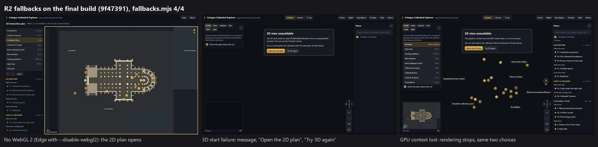

**Security and console.** The app frame was served with this Content Security Policy:

`base-uri 'self'; child-src 'none'; connect-src 'self'; default-src 'self'; font-src 'self'; form-action 'none'; frame-ancestors 'self' https://*.powerapps.com https://play.managedapps.cloud.microsoft https://play.preview.managedapps.cloud.microsoft; frame-src 'self'; img-src 'self' data:; manifest-src 'none'; media-src 'self' data:; object-src 'self' data:; script-src 'self'; style-src 'self' 'unsafe-inline'; worker-src 'none';`

The app worked within it: it made no external requests, logged no errors or warnings and caused no CSP violations. Only the player's own shell logged messages: 4 in the first run and 6 in the second. The saved results keep only that count; the shell messages inspected during the session were permissions-policy warnings about `unload`.

## Total time

The user asked for the total time to completion to be recorded. All times below are UTC, which is the same as UK time in November, and are taken from the session's event log. The clock starts at the first prompt, 14:47:06 on 18 November 2026.

| Milestone | Time | Elapsed |
|---|---|---|
| First prompt | 18 Nov 14:47:06 | 0:00:00 |
| Managed app created (`ms app create`) | 14:56:45 | 0:09:39 |
| First source file written | 16:15:39 | 1:28:33 |
| First build and first screenshot | 21:36:55 | 6:49:49 |
| First full-UI test run (ui1) | 19 Nov 00:09:51 | 9:22:45 |
| Performance fix verified | about 00:51 | about 10:04 |
| First deployment live (`5c5ab91`) | 01:16:21 | 10:29:15 |
| Final commit (`9f47391`) | 01:59:21 | 11:12:15 |
| Final deployment live | 02:00:43 | 11:13:37 |
| Final deployment verified in the player | 02:06:54 | 11:19:48 |
| Task complete: fallback test, evidence, this log and clean-up done (only the final reply to the user followed) | 02:42:55 | 11:55:49 |

**Which number to use**
- **Time to a finished, verified app: 11 h 19 min 48 s.** This runs from the first prompt until the final build was live and had passed every check in the player. The app did not change after that.
- **Time to a deployed app: 11 h 13 min 37 s.** The final build went live at this point. An earlier version, before the label-layout polish, was live after 10 h 29 min.
- **Whole task: 11 h 55 min 49 s.** This adds the work after verification: the fallback test, the evidence sheets, redaction, the final sections of this log and clean-up. The user asked for the log and the time record, so this is part of the task, but it is not app-building time.

**Where the time went**

Figures from the session's event log, up to 02:42 UTC, when this section was finalised:

| Measure | Main agent | Subagents | Total |
|---|---|---|---|
| Model calls | 1,242 | 145 | 1,387 |
| Tool calls | 1,922 | 248 | 2,170 |
| Output tokens | 3,700,601 | 374,575 | 4,075,176 |
| … of which reasoning | 3,030,159 | 286,769 | 3,316,928 |
| Input tokens | 167.7 million | 19.2 million | 186.9 million |
| … of which read from the prompt cache | 157.6 million | 18.0 million | 175.6 million |
| … of which written to the prompt cache | 10.1 million | 1.2 million | 11.3 million |

- **Tools.** The most used were `view` (964 calls), `grep` (394), `powershell` (336), `edit` (290), `create` (59) and `web_fetch` (50). At least one tool was running for only 64 of the 716 minutes (9%).
- **Compactions.** The context was compacted 96 times, and work was blocked waiting for compaction for 27.2 min in total.
- **Subagents.** `cologne-facts` (Claude Sonnet 5.5) gathered a sourced fact for each place in the app, and where it sits in the building (20.4 min, 90 tool calls). `buildlog-writer` (Claude Opus 5.5) drafted this log while the main agent carried on with the deployment (33.7 min, 158 tool calls).
- **No idle time.** No gap between consecutive events was longer than 12 minutes, so all of the elapsed time was working time.

The time was spent almost entirely on the model's own thinking and writing, not on waiting for tools. Context compactions, and re-reading code after them (see [Process notes](#process-notes)), were the main avoidable cost.

## Privacy and redaction

This folder is meant to be shareable, so it leaves out anything that identifies the account, the tenant or the deployed app.
- **Signed-in account.** The managed-app player shows the signed-in account in its header. That header was cropped from every player image before it was saved here: sheets 11–13 and the six `deploy/player_*.jpg` images.
- **Result files.** In the JSON files in `deploy/` and `polish/`, the following were replaced:
  - the app's gateway host with `<app-gateway-host>`;
  - any GUID or 32-character hexadecimal string with `<id>`;
  - any email address with `<account>`.

  The player URL keeps only the public player host; the app's ID is replaced with `<id>`. After redaction, all eight JSON files were scanned again and contained no GUIDs, 32-character hexadecimal strings or email addresses.
- **Not in this log.** The app's ID and its player URL appear nowhere in this log or its images.
- **Kept private.** The following stay in the session's private folder and are not part of this report:
  - the uncropped originals;
  - the signed-in browser profile;
  - the test scripts named in this log, such as `ui.mjs`, `player.mjs`, `player2.mjs`, `player_fps10.mjs`, `labelcheck.mjs`, `hashcheck.mjs` and `fallbacks.mjs`, because the player scripts contain the app's URL and sign-in steps;
  - the script that made the evidence sheets and did the redaction (`make_polish_assets.py`).
- **Reference images.** `research/00_reference-study.jpg` shows downscaled copies of openly licensed pack references, credited in the [image index](#image-index). The app itself contains no reference image.

## Self-check table (BRIEF §6)

BRIEF §6 asks for every ID in section 3 to be checked in the running app, reported as ID → status → how it was verified, with the main sources and anything not completed. This is the table the model gave at the end of the run. Every check ran against the final build `9f47391`:
- **ui7** is the local Playwright suite in headless Edge. It runs five suites (desktop 1440 × 900, tablet 1024 × 768 with touch, portrait 820 × 1180 with touch, reduced motion and the 2D plan) and passed 52/52.
- **player** means `player.mjs` (16/16) and `player2.mjs` (7/7) in the managed-app player, signed in.
- **fallbacks** is `fallbacks.mjs` (4/4).

"Met (self-judged)" marks the two items that depend on visual judgement; a reviewer may judge them differently.

| ID | Status | How it was verified |
|---|---|---|
| R1 | Met | Deployed to the managed-app player and opened there in 7.3 s with WebGL 2. No app console errors in any player check or any ui7 suite, and no CSP violations in the player. |
| R2 | Met | All geometry is generated in code at start-up: 55 merged meshes and 36 instanced meshes (3,444 instances), 686,847 triangles, no model files. The 2D interactive plan (33 places, level filter) passed in ui7 and the player. fallbacks: the 2D plan opens automatically without WebGL 2; clear messages on a start failure and on GPU context loss, each with "Open the 2D plan" and "Try 3D again" (sheet 16). |
| R3 | Met | The app frame made only same-origin requests: 11 and 22 in the two player runs, and none external in the ui7 desktop and 2D-plan suites, which record every request. No reference photo is displayed or bundled. |
| R4 | Met (self-judged) | Screenshots compared with plan P02, elevation E01 and photos X01 and X17: the 157 m twin towers dominate a 144.58 m body with a tall, narrow nave, a short transept and a long choir. |
| M1 | Met | West front and Spires close-up views: square storeys to 76 m, octagonal belfries to about 97 m, openwork spires of instanced ribs, crockets and tracery frames, with finials. |
| M2 | Met | Bird's-eye view and 2D plan: cruciform plan, five-aisled nave, three-aisled transept with gabled end façades, long choir. |
| M3 | Met | Chevet view, bird's-eye view and 2D plan: apse, ambulatory and seven radiating chapels. |
| M4 | Met | Chevet and south views: flying buttresses and pinnacles around the nave and choir, built as instanced meshes. |
| M5 | Met | Steep lead-grey roof; slender crossing tower (109.12 m) topped by a gilded star. |
| M6 | Met | Nave interior and High choir views: clustered piers, 43.35 m vault, triforium band, tall coloured clerestory windows, furnished high choir. |
| M7 | Met | "Crypt & treasury" (about −4 m, estimated) and "Excavations" (about −6 m, estimated) levels show a simplified crypt, treasury and excavation zone. |
| M8 | Met | Ground plane, the Domplatte to the west and Roncalliplatz to the south, labelled N, E, S and W, the Rhine to the east and the Hohenzollern Bridge to the north-east. The player check confirmed these context labels are shown, and hidden when the building is in front of them. |
| N1 | Met | ui7: damped mouse orbit, pan and wheel zoom, keyboard and on-screen buttons. Distance limited to 3–900 m. The camera stays above 1.2 m unless a below-ground level is selected (then −14 m). Touch, emulated: drag to orbit and pinch to zoom on tablet and portrait. The player repeated mouse, buttons, arrow keys, limits and touch. |
| N2 | Met | 12 named views with smooth fly-to, for example West front, Chevet from the east, Bird's-eye plan, Nave interior, High choir and Long section (E–W). The viewing platform and the roof attic are reached as levels (F1), not named views. ui7; in the player, all 12 views arrived exactly on target. |
| N3 | Met | Home button and the `h` key restore the default view and state; ui7 and player. |
| N4 | Met | Double-click flies to the clicked point; "Fly to" in each info card flies to that place; ui7 and player. |
| F1 | Met | Eight levels with heights: Spire tips 157 m, Viewing platform 97.25 m, Bell chamber 53 m, Roof walkway & attic 47 m, Triforium & organ 20 m, Cathedral floor 0 m, Crypt & treasury ≈ −4 m (est.), Excavations ≈ −6 m (est.); ui7 and player. |
| F2 | Met | A level cuts or ghosts everything above it (for example at 58 m for the roof level), moves the camera there and filters the place markers; ui7 and player. |
| F3 | Met | Exterior, interior and x-ray switch (buttons and the `e`, `i` and `x` keys); x-ray ghosts the shell and keeps the piers solid; ui7 and player. |
| F4 | Met | Horizontal cut with a height slider (set to 14 m, read back as "14.0 metres above the floor"), plus east–west and north–south vertical cuts with offset sliders that show the vault, triforium, clerestory and roof in profile. ui7 tested all three cuts; the player tested the east–west cut. |
| F5 | Met | Minimap drawn from the model's own plan data, with camera position and direction, the current level and the places; clicking it moves the camera; ui7 and player. |
| I1 | Met | 33 places as 3D markers, including all 17 required ones, each with name, level, fact and sources; clicking opens the card and Esc closes it; ui7 and player. |
| I2 | Met | Search and a list grouped by level and zone (8 levels, 21 zones); "Richter", "shrine" and "bell" find 1, 1 and 2 places; ui7 and player. |
| I3 | Met | 13-stop tour with next, previous, play and pause, including all eight required stops; ui7 and player. |
| I4 | Met | Key figures: 10 researched figures as labelled 3D dimension lines, for example towers 157.22 and 157.18 m, length 144.58 m, transept width 86.25 m, nave vault 43.35 m, platform 97.25 m and 533 steps; ui7, and `labelcheck.mjs` found no overlaps at three sizes. |
| I5 | Met | Time-of-day slider: 08:00 at the equinox setting gives a sun elevation of 18° and azimuth of 114°, which matches the sun's position for Cologne. Night mode floodlights the façades and lights the coloured glass from inside. ui7 tested the slider and night mode; the player tested night mode. |
| I6 | Met | South-tower route highlighted, with stages at 0, about 22, 53 and 75 m and the platform at 97.25 m, and a step slider (step 291 is at 53 m; 533 steps in total); ui7 and player. |
| Q1 | Met | 10 s frame counts in the player: default exterior 60.1 fps and x-ray 60.0 fps; interior 40–58 fps. Instancing (3,444 instances), merged geometry (50 draw calls at the home view) and interior culling. A progress bar with stage names shows during generation. |
| Q2 | Met | The 3D view keeps 56% of a 1440 × 900 window, 43% on tablet and 36% in portrait (28–33% with an info card open on the smaller screens); player: 56% at 1440 and 42% at 1024 px wide. |
| Q3 | Met | ui7: no unnamed controls; Tab reaches all 55 controls with a visible focus ring; keyboard shortcuts with a `?` help overlay; every place in a DOM list; `prefers-reduced-motion` switches on the app's reduced motion. |
| Q4 | Met | The About panel lists sources (48 links) and 12 image credits with author and licence from `ATTRIBUTION.md`, says no image is bundled, and states that the model is "an interpretation for learning, not a survey", with estimates marked; ui7 and player. |
| Q5 | Met (self-judged) | Dark theme with gold accents, consistent panels, type scale and focus states. The building in dark weathered stone, lead roof, warm interior and coloured glass, compared with the pack's photos. Label legibility was fixed after the player screenshots (R14, R15). |

**Main sources for facts**
- Hohe Domkirche Köln, `koelner-dom.de`: "Der Dom in Zahlen" (the cathedral in numbers), the tower climb, works of art, excavations and history pages.
- Wikipedia, English and German: Cologne Cathedral, the crossing tower (Vierungsturm) and the Hohenzollern Bridge.
- UNESCO World Heritage List, entry 292 (Cologne Cathedral).
- Wikimedia Commons plans, and the pack's `references/ATTRIBUTION.md` and `SOURCES.json` for image credits.

**Assumptions**
- The sun position uses local solar time for Cologne, not clock time.
- The crypt and excavation depths are estimates and are labelled as such.
- For tower heights, the model uses the cathedral's own figures (157.22 m south, 157.18 m north); English Wikipedia's 157.38 m is noted in the app.

**Not completed, and honest gaps**

Every ID in section 3 is met. These limits remain:
- **Approximate geometry.** Proportions follow measurements taken from the plans and photos, but the model is an interpretation; window tracery and the interior are simplified.
- **Touch.** Touch input was emulated; it was not tested on a physical touch screen.
- **Interior frame rate.** In the player, the interior runs at 40–58 fps: above the 30 fps target but below the 60 fps of the exterior.
- **Interior culling** changes about 0.009% of pixels in the measured views.
- **Label occlusion.** World labels are hidden behind 13 coarse boxes, not the exact model, and they have no hysteresis. The numbered place markers draw through the building by design.
- **Key figures.** In Key figures mode, place markers that would touch a figure label are hidden, and at 1440 × 900 the Domplatte and Museum Ludwig labels give way to the figures.
- **Overlap audit.** The small caption under each compass letter is outside the rectangle that the audit measures.
- **Context loss.** After a GPU context loss, the floating labels stay over the blank view until the user chooses "Try 3D again" or the 2D plan.