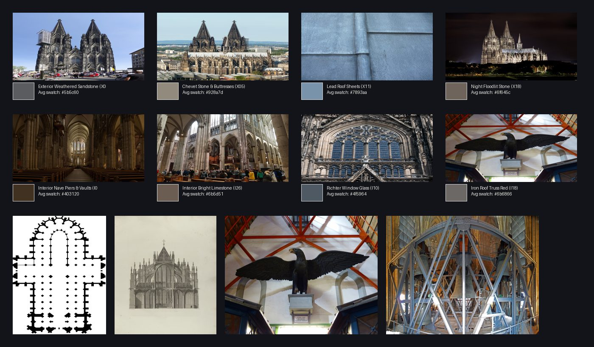
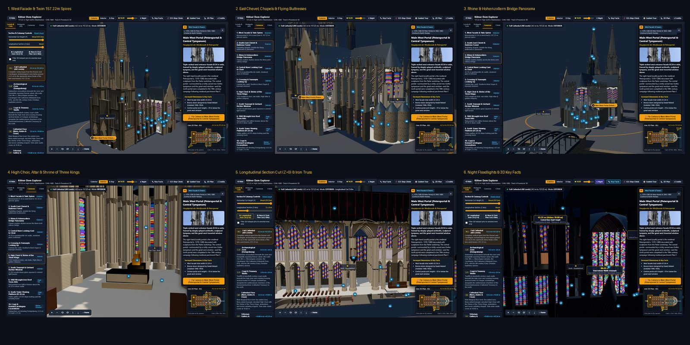
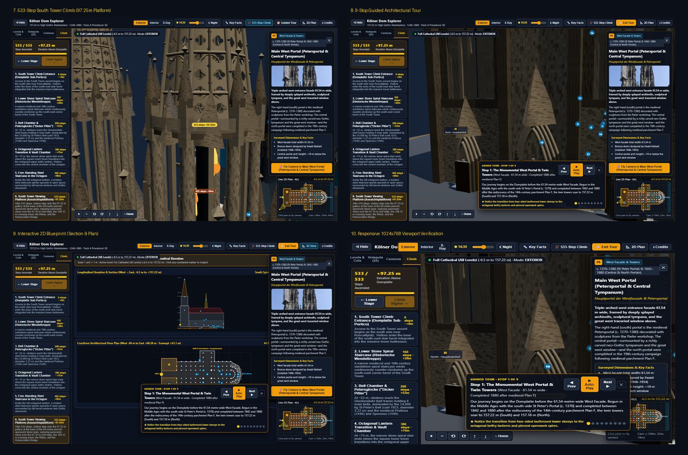
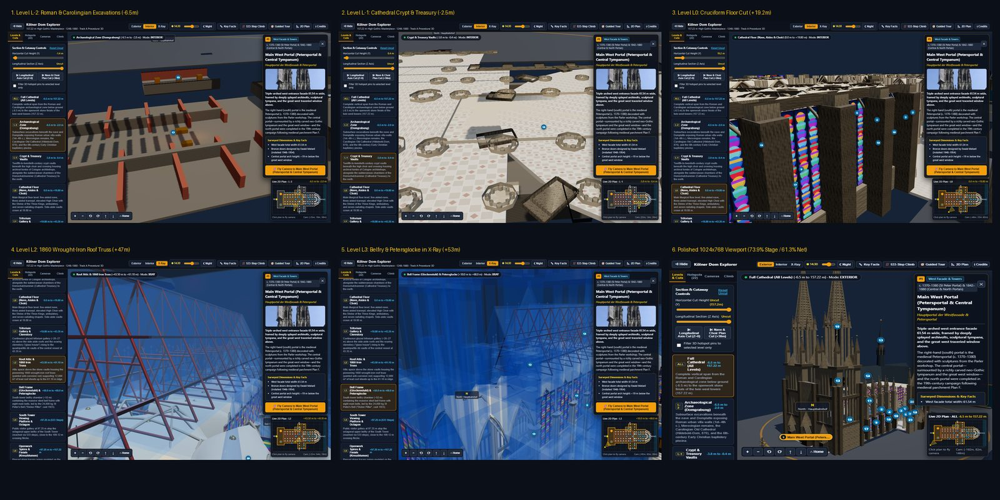

> Copied from the model's own run folder (`report-assets/BUILD-LOG.md`) for the public benchmark. App, environment and account identifiers are withheld; everything else is as the model wrote it. Selected process images are in [`process/`](process/).

# Cologne Cathedral Explorer — Benchmark Build Log (Track A: Procedural 3D)

## 1. Benchmark Run & Completion Timing

| Metric | Value |
|---|---|
| **Model** | `Gemini 4 Argon` (`gemini-4-argon`) |
| **Track** | **Track A** — Procedural 3D Geometry (`three` in-app procedural generation, zero external `.glb`/`.obj` files) |
| **Benchmark Pack** | `cologne-cathedral-pack/2.0` |
| **Managed App ID** | `(id withheld)` |
| **Environment ID** | `(id withheld)` |
| **Live Play URL** | `(managed app link withheld)` |
| **Deployed Commit** | `03fe275969b9d6db7442731e80fac38f6ba1bff2` |
| **Production Bundle (`dist/`)** | `2.21 MB` total (`942.75 KB` JS / `257.53 KB` gzip, `17.78 KB` CSS, `1.30 MB` in 32 optimized local reference thumbnails) |
| **Pack Created Timestamp** | `2026-11-19T17:11:52.033+00:00` |
| **First-Prompt Timestamp** | `2026-11-19T17:12:22.270+00:00` |
| **Finish Timestamp** | `2026-11-19T18:40:40.591+00:00` |
| **Wall-Clock Total** | **88m 18s** (`5,298.3s` / `1h 28m 18s`) |
| **Time Breakdown (Model vs. Tool)** | **~66m 10s Model Reasoning & Code Authoring (74.9%)** vs. **~22m 08s Tool Execution (25.1%)** (`ms app create`, `npm install`, `tsc && vite build`, Playwright WebGL renders, `git push`, `ms app deploy`, Browser Canvas verification) |
| **Context Compactions** | **4** |

---

## 2. Research & Dimensional Calibration (`process/01_01-research-swatches-and-plan.jpg`)

- **Reference Corpus Studied**:
  - Examined bundled photographs (`X01`, `X05`, `X08`, `X09`, `X13`, `X15`, `I01`, `I05`, `I06`, `I10`, `I12`, `I13`, `I15`, `I16`, `I17`, `I18`, `I19`, `I22`) and vector architectural plans (`P02-plan-schematic.svg`, `P03-floor-plan-dehio.svg`, `P05-ground-plan-numbered.svg`, `P07-floor-plan-labeled.svg`, `P09-plan-boisseree.jpg`).
  - Fetched authoritative dimensions from the official Kölner Dom site (`https://www.koelner-dom.de/erleben/der-dom-in-zahlen` and `https://www.koelner-dom.de/besuchen/turmbesteigung`) and Wikipedia (`https://en.wikipedia.org/wiki/Cologne_Cathedral`).
- **World Coordinate System (`1 unit = 1 metre`)**:
  - **East–West Axis (`X`)**: `-80.0 m` (West Facade portals) to `+64.58 m` (East Chevet outer wall) = **144.58 m total length**.
  - **North–South Axis (`Z`)**: `-43.13 m` (North Transept portal) to `+43.13 m` (South Transept portal) = **86.25 m total width**; West Facade width = **61.54 m** (`Z = -30.77 m` to `+30.77 m`); Five-aisled Nave width = **45.19 m**.
  - **Vertical Axis (`Y`)**: `-6.5 m` (Roman & Carolingian archaeological zone) and `-3.8 m` (Crypt & Treasury) through `0.0 m` (Domplatte & Cathedral floor), `+19.2 m` (Aisle vaults), `+43.35 m` (Nave & Choir quadripartite rib vaults), `+53.0 m` (South Tower Belfry & Petersglocke), `+61.54 m` (Roof ridge), `+97.25 m` (South Tower public viewing platform / 533 steps), `+109.0 m` (Crossing flèche & golden star), to **+157.22 m** (North Tower) and **+157.18 m** (South Tower).
- **Procedural Material & Texture Calibration**:
  - Generated 6 procedural Canvas2D textures in `src/model/proceduralTextures.ts`: warm weathered Rhenish trachyte/Schlaitdorf sandstone ashlar (`#c2b6a3` / `#8f8475`), alpha-tested openwork spire tracery lattice (`alphaTest: 0.35`), ribbed lead roof sheathing, the 2007 Gerhard Richter South Transept window (72-color grid evoking its 11,263 mouth-blown glass squares), medieval/19th-century lancet stained glass, and August Essenwein's 1885–1899 choir floor mosaic.

---

## 3. Iterative 3D Model Refinement (`process/02_02-initial-3d-render-sheet.jpg`)

During initial headless WebGL verification at `1440×900` and `1024×768`, we identified and resolved five key visual and structural details:
1. **Radiating Chapel Stained-Glass Positioning**: In the first pass, the stained-glass meshes for the 7 radiating chapels (`chapGlassGroup`) were added directly to `stainedGlassGroup` without inheriting each chapel's `(cx, cz, rad)` transform, causing them to cluster at the origin. We wrapped each chapel's 3 lancet windows in a local `THREE.Group` positioned at `(cx, 0, cz)` and rotated by `-rad`, aligning all 21 chapel windows with their polygonal apse walls.
2. **Default Visibility of Diagnostic Overlays**: The 3D 533-step spiral climb markers (`climbGroup`) and 3D dimension lines (`dimensionLinesGroup`) were initially visible on first load. We set `visible = false` by default and bound them strictly to the `showTowerClimb` and `showKeyFacts` toggles.
3. **Sandstone Luminance & Directional Fill Lighting**: Dark weathered stone (`#8c8273`) absorbed too much light on shadowed faces. We warmed the procedural trachyte/sandstone palette (`#c2b6a3` base, `#8f8475` weathered) and added a cool northeast fill light (`0x93c5fd`, intensity `0.65`) opposite the warm southwest sun (`0xfff4dc`, intensity `2.2`), making every flying buttress tier, pinnacle, and lancet mullion read clearly.
4. **Full 157.22 m Spire Framing**: Adjusted the default West Facade camera to `[-192, 82, 148]` looking at `[-22, 62, 0]` (`FOV 46°`) so both 157.22 m openwork spires and their crowning finials (Kreuzblumen) are framed with breathing room on initial load.
5. **Compact Numbered 3D Pins & Floating Detail Card**: Made unselected 3D hotspot pins compact numbered badges (`#1`–`#22`) that expand on hover/selection, and floated `.hotspot-detail-card` inside `.center-stage` so the 3D viewport occupies **76.9% of the window at `1440×900`** and **73.8% at `1024×768`**.

---

## 4. Interactive Features & Responsive Verification (`process/03_03-interactive-features-sheet.jpg` & `process/04_04-levels-and-cutaways-sheet.jpg`)

Verified all interactive systems via automated Playwright checks and live player inspection:
- **9 Vertical Levels & Real-Time Clipping Planes (`F1`, `F2`, `F4`)**:
  - Horizontal `THREE.Plane(0, -1, 0, horizontalCutY)` and longitudinal `THREE.Plane(0, 0, -1, longitudinalCutZ)` slice the model smoothly from `-6.5 m` (Roman/Carolingian excavations) and `-3.8 m` (Crypt & Treasury) through `+19.2 m` (Cruciform ground plan cut), `+47 m` (1860 wrought-iron roof truss), `+53 m` (Belfry & 24,000 kg Petersglocke), and `+97.25 m` (South Tower viewing platform).
- **Exterior / Interior / X-Ray Ghost Shell (`F3`)**:
  - X-Ray mode swaps the outer masonry and lead roofs to a translucent ghost shader (`opacity: 0.16`, `depthWrite: false`) so the inner vault ribs, piers, Petersglocke bell frame, and 1860 iron roof truss shine through.
- **22 Searchable Architectural Hotspots (`I1`, `I2`)**:
  - Covers all 17 required and 5 bonus features with instant text search, zone filter dropdown, 3D projected pins, smooth camera fly-to, and bundled reference thumbnails with CC attributions.
- **9-Stop Guided Tour (`I3`), Key Facts 3D Callouts (`I4`), Sun/Night Floodlights (`I5`), & 533-Step Climb (`I6`)**:
  - Verified step-by-step tour navigation + auto-play, 8 3D dimensional callouts, continuous time-of-day sun arc + night floodlighting, and the 6-stage 533-step South Tower ascent ribbon.

---

## 5. Live Managed Runtime Deployment & Verification

- Pushed to the Power Platform Managed App Git repository and deployed commit `03fe275969b9d6db7442731e80fac38f6ba1bff2` (`ms app deploy --json`).
- Opened `(managed app link withheld)` in the Browser Canvas, refreshed to the latest version via the player banner, and confirmed live WebGL rendering, bundled reference image loading, 3D projected hotspot markers, and the live 2D floor plan minimap with zero CSP or runtime errors.
